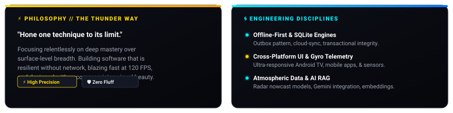
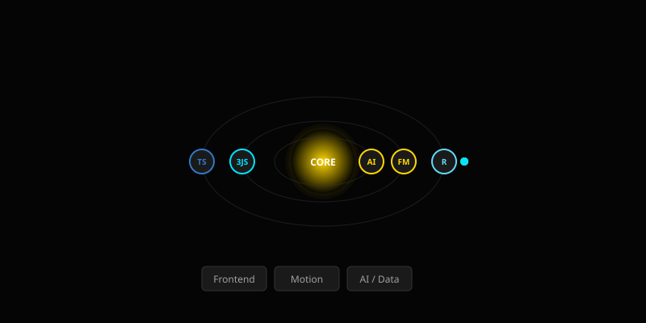
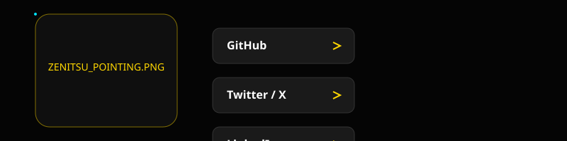

  

  

  ### <i>"If you can only do one thing, hone it to perfection. Hone it to the utmost limit."</i>
  **— Zenitsu Agatsuma (雷の呼吸 • 霹靂一閃)**

   

  
  
  

    

---

## 🪪 Slayer Corps Developer License

  

 

---

## 🌀 The Zen Garden // Core Disciplines

  

 

---

## ⚡ Electric Tech Orbit

  

 

### 🛠️ The Tactical Arsenal

| Domain | Weaponry &amp; Technologies |
| :--- | :--- |
| **Mobile &amp; Systems** |      |
| **Web &amp; Frontend** |     |
| **Backend &amp; Cloud** |      |
| **AI &amp; Intelligence** |    |

 

---

## 🗡️ Featured Production Weapons

| Project | Description | Architecture &amp; Stack | Status |
| :--- | :--- | :--- | :---: |
| 📚 **[Study Vault](https://github.com/roshzxn1003/study_vault)** | Offline-first student companion &amp; academic knowledge vault with local SQLite caching, Supabase cloud sync, and Gemini AI RAG tutoring. | `Flutter` • `SQLite v5` • `Supabase` • `Riverpod` • `Gemini AI` | 🚀 **v1.0 Ready** |
| 🌩️ **[AeroCast Now AI](https://github.com/roshzxn1003/AeroCast-Now-AI)** | High-resolution atmospheric nowcast radar interpolation and severe weather telemetry predictive engine. | `Python` • `TypeScript` • `React` • `Tailwind` • `FastAPI` | ⚡ **Live** |
| 🎮 **[GyroPad Engine](https://github.com/roshzora)** | Low-latency Android TV virtual gamepad turning smartphones into gyroscopic precision motion controllers. | `Flutter` • `Android SDK` • `UDP Telemetry` • `Kotlin` | 🛠️ **Active** |
| 🌐 **[Roshzen.in](https://github.com/roshzxn1003/roshzen.in)** | Cyberpunk-minimalist personal portfolio, interactive digital laboratory, and tech showcase. | `Next.js` • `React` • `TypeScript` • `Framer Motion` | 🌐 **Live** |

 

---

## 📊 Battle Analytics & Telemetry

  
  

 

---

## ⚡ Connect & Transmit

  

    

  
  &nbsp;
  
  &nbsp;
  
  
    
  
  
  
  

    <i>Crafted with ⚡ <b>Thunder Breathing : First Form</b> by <b>Arun Roshan (ROSHZEN)</b></i>
  

